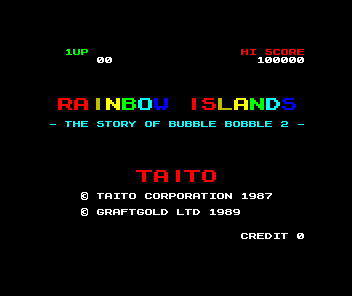
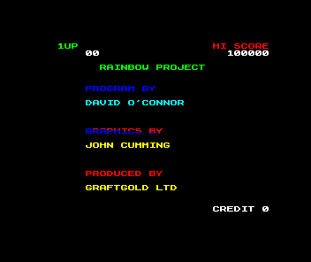
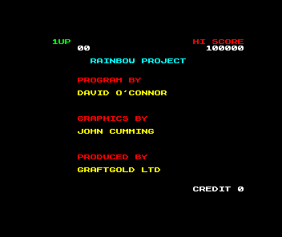

# Six +2A/+2B audio expectations after physical WAIT

We qualify only the RoboCop, Out Run and Where Time Stood Still audio windows
on +2A and +2B. Their complete screen hashes stay unchanged. The ten +3 cases
in [#2265](https://github.com/emu198x/emu198x/issues/2265) retain their existing
expectations and remain open.

The [physical WAIT fix](https://github.com/emu198x/emu198x/pull/2285) changed
CPU bus timing. These six recordings retain the same music commands, with
Out Run displaced by one music field. The exact waveform changes because
AY clock phase and command arrival edges change. This is a qualification of
these catalogue windows, not an independent measurement of analogue sound.

| Game, on both boards | Old audio | Qualified audio | Command comparison |
|---|---|---|---|
| RoboCop | `d175d0946abcd29d` | `75dc5b625c861ae6` | All 1,200 commands, all 100 fields identical |
| Out Run | `56e8f046d843cf21` | `b9409931fe776915` | All 1,287 commands in 99 overlapping fields identical; new field 1 matches old field 0 |
| Where Time Stood Still | `72247e53c91f6a20` | `520fd8f8ff2724d4` | All 1,100 commands, all 100 fields identical |

Hashes in this table are xxh64 of the **complete WAV file**, including its
header. Each file is mono 44,100 Hz, 16-bit PCM: 88,200 samples, 176,444 bytes.
The corrected +2A and +2B files are byte-identical for each game. Frame/audio routing
versions remain 6/4: the audio routing has not changed.

## Baseline and visual anchors

The retained original capture producer reproduces every original frame and
audio hash for the three +2A games. It is not assumed correct merely because
it is old. The immediate pre-WAIT source independently reproduces those
normal-capture audio hashes through the observer, as does current main for
the corrected outputs.

The unchanged pixels show RoboCop's high-score table (MURPHY 50000), Out Run's
three-choice menu (OUT RUN / UNDEFINED / CONTROLS), and Where Time Stood
Still's control-selection menu. They are not loader stripes or running
gameplay. Their exact existing hashes remain `587a604f94d1ff74`,
`1838727d99e21182` and `076876874e1f4725`, respectively. No startup action,
waypoint, mask, media, firmware, frozen fixture or frame expectation changes.

The observed source revisions are pre-WAIT
`f176914a335b45932d936f36f454d681b3520c08` and current main
`e125cf697505f19243f8fdfb74a3412affb0bb30`. Current main also includes the
separate 48K keyboard fix; the observed Amstrad WAV hashes exactly reproduce
the earlier WAIT recapture, so this comparison does not attribute an
unmeasured change to it.

## What actually moved

The corrected firmware menu is detected at native frame 56, master time
19,854,240. Before WAIT it is frame 55, master time 19,499,700. Ordinary tape
autoload begins one field later. Every corrected audio window also begins
exactly **354,540 master ticks later** and covers exactly 35,454,000 ticks
(100 native fields).

That extra field supplies 35,454 AY input clocks. For all three games, adding
those clocks to the original AY state predicts the corrected prescaler and
Bresenham sample remainder **exactly**, using the chip's existing integer
arithmetic. Noise/tone oscillator phase can therefore change without a
changed music command. RoboCop and Where Time Stood Still retain all 100
per-field PC/register/value sequences. Out Run retains all 99 overlapping
sequences at the explicit one-field displacement above. Its remaining first
field writes registers 0–12 to exactly the values stored at the old window's
start, after applying the published AY crate's existing register-width masks
(one raw bus value is 200, stored as 8). That bridges the initial field without
publishing the musical data or guessing its phase.

Matching commands do not arrive at identical native clock edges. RoboCop's
1,200 command edges differ by either +3 or -17 master ticks; the other two
have several measured offsets. [The aggregate analysis](analysis.json)
records the complete offset distributions. The changed CPU sampling and
contention path affects these edges as well as the initial boot duration.

The waveform differences are substantial. Only 74,625 of 88,200 RoboCop
samples are equal; Out Run has 5,361 equal samples and Where Time Stood Still
1,106. Correlation or a claim of tiny rounding error would not justify the
new expectations. We instead compare the actual commands, clock phase,
ordinary capture bytes and unchanged semantic screens.

## A hypothesis that failed

On the old build, delay ordinary tape autoload by exactly one native field,
chosen from the measured boot-time difference. Do not sweep delays or edit
chip state. This aligns the absolute recording start, prescaler and sample
remainder with the corrected run. It **does not** reproduce any corrected
WAV hash: the test's predicted-hash assertions fail (exit 101), and all raw
results are retained.

For RoboCop the delay makes the entire initial AY state identical, while
all 100 command sequences also match. Its audio still differs because the
commands arrive at different clock edges. Where Time Stood Still retains
tone-phase differences; Out Run retains a one-field music-command displacement.
The extra boot field explains the sample-clock phase but is not a complete
waveform explanation by itself. We do not adjust the capture time or chip
state to force old samples to match.

A separate zero-delay control must reproduce the entire original audit,
including every command and timestamp. The observer also verifies the normal
capture hash in each unmodified old/new run. These controls distinguish a
real timing change from an observation or harness side effect.

## Reproduction and retained data

`observer-before.rs` and `observer-current.rs` contain the temporary ignored
catalogue-local probes. In each corresponding source checkout, append
`#[cfg(test)] mod audio_oracle_audit;` to the catalogue library and place the
probe at `src/audio_oracle_audit.rs`. In the existing armed AY-write-watch
branch of the Amstrad core, immediately after its `w.record(...)`, add:

```rust
 eprintln!("AY_EDGE {} {} {} {}", self.hc, self.z80.regs.pc,
           self.ay.selected_register(), data);
```

Build the catalogue library tests in release mode. Run only
`audio_oracle_audit::observe_amstrad_audio_window`, with `--ignored --exact
--nocapture`, from `crates/emu198x-catalogue`. The probe uses the existing real
firmware/media loading, tape completion, waypoint and audio capture path.
Set `EMU198X_AUDIO_AUDIT_ID`, `EMU198X_AUDIO_AUDIT_OUT`,
`EMU198X_AUDIO_AUDIT_EXPECT` and `EMU198X_AUDIO_AUDIT_DELAY` (0 normally, 1 for
the rejected delay hypothesis). Each child has a 300-second bound. Watch
records are checked against their cap and cleared every field; a truncated
observation fails. No guest code, hardware clocks, API or save schema changes.
The current probe also has a cheap `observe_amstrad_boot_time` test.

The diagnostic source and prints are removed before building the shipping
producer. `analyse.py --self-test` exercises altered-command and absent-data
controls. Run `analyse.py --observations PATH --output analysis.json` on the
retained raw observations; it requires all three games, complete durations,
normal hashes, command matches, non-empty edge logs, exact phase predictions,
the rejected-delay results and successful zero-delay controls.

Raw musical command streams, recordings, original media and firmware are not
published here. The private, fully hashed recovery archive retains these
observations, probe sources/patches, retained capture/observer binaries and full logs. The current audio observer
is reproducible from its source, patch, build log and normal-capture controls. Public
records contain aggregate counts, identities and the reproducible analysis.
The preceding [WAIT evidence](../2026-11-04-amstrad-wait-evidence/README.md)
retains the source-backed timing diagnosis and full original 103-entry run.

## Integration verification

Source PR: [emu198x/emu198x#2288](https://github.com/emu198x/emu198x/pull/2288),
capture source head `241166e71fbf365a7d326ea0403e665637950894`; final reviewed
head `22e3b59d07d923461c2e37cb144e7002847515b1`. The final commit only clarifies
two comments. [Identity proof](source-identity-proof.json) verifies unchanged
parsed catalogue data and no shipping Rust changes.
[Local checks](local-validation.json), [stale-oracle rejection](stale-oracle-control.json)
and [altered-command rejection](altered-command-control.json) are complete.
The [complete recapture](recapture.json) ran all **103 entries** in 2,872.57
seconds, with **zero errors or timeouts**. **93 match both expectations**;
only the original ten +3 cases remain. Five frame and nine audio expectations
still differ. [The completion check](recapture-comparison.json) verifies every
observed frame/audio pair is unchanged from the previous post-WAIT run, every
frame expectation is untouched, and exactly the six investigated audio
expectations changed. The [paired-board recordings](paired-board-audio.json)
are byte-identical for each game. Original inputs and the producer binary
remain unchanged throughout the run. This does not close #2265.

`check_recapture.py --self-test` rejects incomplete, empty, duplicate and
failed capture sets. The real completion check requires exactly the six
qualified IDs and exactly the ten retained failures; it cannot pass a partial
or empty report.

## Separate lead: Rainbow Islands' rejected reference image

The original Rainbow Islands EDSK declares 45 tracks, but tracks 39–44 have
zero size in the size table. Its entire file ends exactly after the declared
track bodies; no trailing track data is omitted. MAME's configured drive
rejects the declared count before booting it.

A separately named **derived diagnostic copy** changes only header byte 48
from 45 to 42. Every other byte, including all track payloads and the size
table, remains identical. This is not an unchanged-image reference boot.
[Input/binary identities and the complete command](rainbow-geometry.json)
record the original/derived SHA-256 and the preserved payload SHA-256. The
original ZIP and the mounted diagnostic copy are verified unchanged after
execution. The temporary reference ROM/disk directory is removed.

With the same MAME binary, original firmware, ordinary ENTER key and
[existing bounded boot script](rainbow-reference-boot.lua), the reference now
boots and shows the Rainbow Islands title page at 120 emulated seconds. The
post-WAIT Emu198x capture shows the credits page. This is a useful reference
path for aligning the attract sequence; it does **not** qualify a replacement
frame oracle, and Rainbow Islands' current expectation stays unchanged.
The MAME 20-second image is black; we do not count that as a completed boot.





These diagnostic captures show Taito's Rainbow Islands and Graftgold's
Spectrum conversion. The software and screen content remain their owners'
work. Only diagnostic images and hashes are published here, not the disk.

A coarse elapsed-after-ENTER control captures at **125.35 seconds**, calculated
before execution as `4.9 + (6000 + 5 + 20) * 354540 / 17734475`. It reaches the
same credits **layout** shown by Emu198x, with different colours. The
[control identity](rainbow-coarse-alignment.json) records this separately;
it does not align natural-keyboard duration or native frame phase.



The subsequent [64-native-field comparison](rainbow-native-comparison.json)
**does not qualify Rainbow's frame oracle**. Our temporary
[ordinary-path observer](rainbow-observer.rs) reproduces the normal post-WAIT
frame hash before collecting 64 indexed frames, with exactly 354,540 master
ticks between them. The [reference probe](rainbow-native-reference.lua)
asserts 64 consecutive native frame numbers and records both native pixels
and screenshots. All buffers are required; a successful process or advancing
counter alone is insufficient.

The first foreground mask matches exactly, but only two of the 64 paired
foreground masks agree. The observed logical-colour image sets do not match.
MAME has one unique image in the window; Emu198x has eleven, including seven
foreground masks. A [software-video/SDL-dummy backend control](rainbow-video-backend-control.json)
reproduces all 64 MAME buffers byte-for-byte. It does not establish the cause
of the sequence difference, or independently prove video freshness; neither
backend provides a matching sequence here. We stop this investigation at
that measured limit. There is no basis for calling it a pure colour-cycle
phase difference or changing the expected hash. The original disk remains
unchanged throughout. All temporary Rust observer code is removed afterward.


Fresh CI on the final head passed **24 checks**, with ten expected
release/build skips; [the complete check record](source-ci.json) identifies
the exact head and replacement PR. The original draft #2287 is superseded by
#2288 after GitHub failed its draft transition. Both use the same final signed
commit; the replacement ran ordinary CI with no check changes.

[Private retention record](retention.json) identifies the completed raw archive:
933 files, every decompressed byte checked against its internal SHA-256
manifest. Capture producers, recordings, native-frame observations, temporary
probe sources/patches and full logs are preserved there. The original capture
head's checks are retained separately in [their own record](source-ci-capture-head.json).
