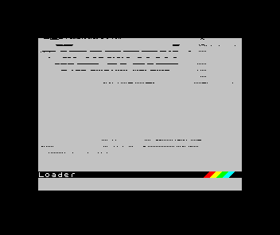
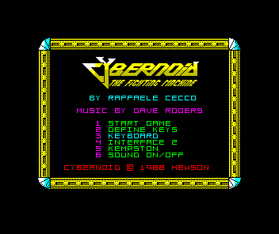
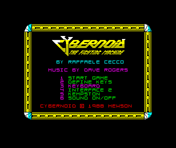

# Amstrad physical WAIT qualification — 2026-11-04

The corrected path keeps the 40077 CPU clock running and feeds its physical
WAIT output to Z80 0.9. It fixes the reproduced refresh-bank slowdown and the
original Cybernoid loader now receives all 49,152 fast-loader bytes exactly as
observed independently in MAME. The source change is
[emu198x#2285](https://github.com/emu198x/emu198x/pull/2285).

The complete registry-only catalogue run captures **103/103 entries, with zero
errors or timeouts**. **87 match both unchanged expectations; 16 differ**.
All 67 non-Amstrad entries match. The sixteen are the original ten +3 cases
plus six audio-only changes on +2A/+2B. Across the run, five frame hashes and
fifteen audio hashes differ. No expected hash has been changed or adopted from
these observations. [#2265](https://github.com/emu198x/emu198x/issues/2265)
remains open for the remaining oracle qualification.

| Entry | Frame versus existing oracle | Audio versus existing oracle |
|---|---|---|
| `robocop-plus2a` | same | differs |
| `out-run-plus2a` | same | differs |
| `where-time-stood-still-plus2a` | same | differs |
| `robocop-plus2b` | same | differs |
| `out-run-plus2b` | same | differs |
| `where-time-stood-still-plus2b` | same | differs |
| `chase-hq-plus3` | same | differs |
| `rainbow-islands-plus3` | differs | same |
| `cybernoid-plus3` | differs | differs |
| `stormlord-plus3` | differs | differs |
| `starglider-2-plus3` | same | differs |
| `lotus-esprit-plus3` | same | differs |
| `tetris-plus3` | differs | differs |
| `robocop-plus3` | same | differs |
| `where-time-stood-still-plus3` | same | differs |
| `dragon-ninja-plus3` | differs | differs |

## What is independently checked

- Published [Z80 0.9.0](https://crates.io/crates/emu198x-zilog-z80/0.9.0) and
  [40077 0.3.0](https://crates.io/crates/emu198x-amstrad-ula-40077/0.3.0)
  archives and implementation sources match the reviewed changes. Normal
  dependency graphs resolve Spectrum only to 0.9 and CPC only to 0.8.
  CPC's original v5 states and three resumed fields remain unchanged; its
  separate timing/save qualification is [#2284](https://github.com/emu198x/emu198x/issues/2284).
- The machine-clock regression measures complete TW pairs and refresh immunity
  over eight distinct arrivals. The old CPU and disconnected WAIT output are
  deliberate failing controls, not ignored regressions.
- The native-save checks cover all three Amstrad boards at eight WAIT offsets,
  with three resumed fields comparing full pixels, audio bits, clocks and final
  state. Original v19 specimens reject atomically under the approved v20 policy.
  The 28-profile version matrix, 352 frozen native-output comparisons and
  296-case video pipeline matrix remain enforced. The emitted SDS evidence
  reports its actual v20 header across 1024 cases.
- The strict real-input regression verifies every full ROM page and the decoded
  DSK before ordinary firmware boot and ENTER input. All 49,152 fast-loader bytes
  match MAME 0.289's transparent native I/O observation, SHA-256
  `f55ada06cff6f6f87f501f9acd3fea7525f7a87dec0bd1021619ec0e0cc188ff`.
  A one-byte ROM mutation rejects before guest execution. There is no memory
  patch, injected loader, disabled contention or relaxed FDC deadline.

## Capture interpretation and limits

The new Cybernoid image shows the intact control menu. The other changed +3
frames show recognizable Rainbow Islands credits, the Stormlord menu, Tetris
logo/scroll and Dragon Ninja controls. These observations establish software
state, not exact hardware phase or replacement frame/audio oracles.

MAME attempted all ten original failing disks with ordinary firmware/keyboard
input. It produced nine capture sets: six show recognizable title/menu/game
content, while RoboCop, Where Time Stood Still and Dragon Ninja remain striped
loader-like displays in that reference. Rainbow Islands' unchanged 45-track
image is refused by the configured 42-track reference drive. Do not describe
these as ten qualified reference boots. The MAME images are taken at fixed
emulated times and are not aligned to the catalogue's post-boot frame waypoint.
The Cybernoid byte stream is the independent oracle; the differently timed
screenshots are not pixel-equivalence evidence.

These diagnostic captures show *Cybernoid - The Fighting Machine* (Hewson
Consultants, 1988). The software remains its owners' work; no ROM, disk or
captured executable bytes are distributed here.

| Before the fix: Emu198x loader failure | Corrected registry-only Emu198x capture | Independent MAME capture at 20 seconds |
|---|---|---|
|  |  |  |

## Reproduction and retained identities

[recapture.json](recapture.json) contains every expected/observed hash and an
explicit result for each of the 103 unique entries. A hash mismatch remains a
mismatch even when the capture process succeeds.

[producer.json](producer.json) records the actual binary, unchanged manifest and
complete source-input identities, concurrency 3 and the 300-second per-entry
limit. The binary was built from the recorded source base plus
[producer.patch](producer.patch), before later test/documentation additions;
it is not claimed to have been built from the later clean review commit.
The final completion marker is emitted only after every entry completes and
binary, manifest and input identities are rechecked unchanged.

[recapture.py](recapture.py) is the typed, Ruff-checked reproducer. It uses the
standard library; Python 3.13+ is sufficient. It refuses a missing/duplicate
case, a failed/timed-out process or incomplete hash output. The output directory
must be new. The executed helper's identity is separately recorded; its original
source and all raw captures are retained in the private recovery archive.

```sh
python3 recapture.py --self-test
python3 recapture.py --binary /absolute/path/to/catalogue \
  --manifest /absolute/path/to/spectrum.toml --output /new/output/directory
```

[validation.json](validation.json), [consumer-graphs.json](consumer-graphs.json),
[mame-attempts.json](mame-attempts.json) and
[mame-visual-review.json](mame-visual-review.json) retain the scope and limits of
the native checks. Source-backed hardware reasoning and the explicit override
of Ferranti clock-gating rules live in the source repository's
[decision](https://github.com/emu198x/emu198x/blob/docs/amstrad-wait-diagnosis/knowledge/decisions/amstrad-wait-contention.md)
and [plan](https://github.com/emu198x/emu198x/blob/docs/amstrad-wait-diagnosis/docs/plans/2026-11-03-amstrad-wait-contention.md).
