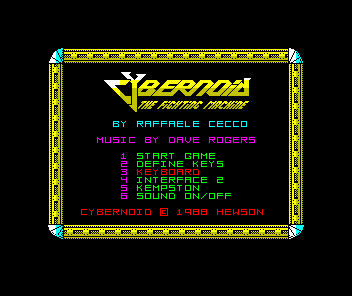
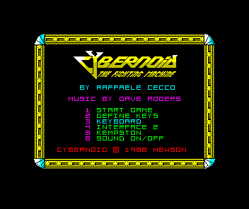
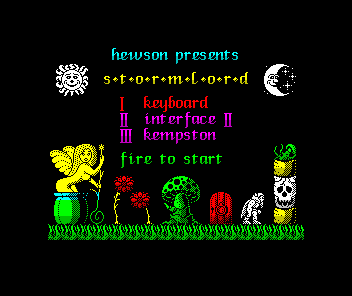
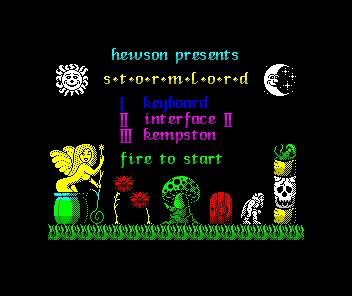
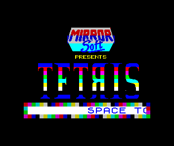
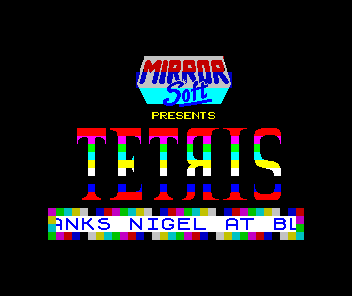
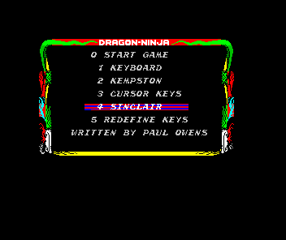
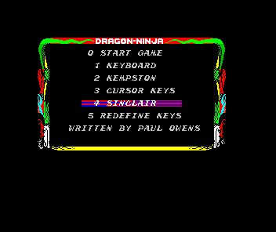

# The last four +3 catalogue cases

We qualify Cybernoid, Stormlord, Tetris and Dragon Ninja's current frame/audio
pairs at their existing fixed waypoints. All four reach the intended original
menu/title state. Their moving pictures and sound differ in execution phase;
no emulator implementation, mask, navigation delay, dependency or save format
changes are needed.

The exact historical producer reproduces all eight original hashes. Ordinary
captures from the current producer reproduce the four outstanding differences
before any expected value changes. Every original/current recording is then
reconstructed sample for sample from observed timed inputs. Dragon Ninja's
picture difference is also reconstructed pixel for pixel by replaying its
original attribute-write times through the current display component.

Source [PR #2293](https://github.com/emu198x/emu198x/pull/2293),
commit `8f7daf62eeb0bf8bedbb6f3e6f4c08b83ae22818`.
Source baseline: `2ae3a51198d9a91fc7c4b04b1babf64c930ee10c`.
Historical source: `cf6ee98c2857c37b0683945107c695c316a49fcc`.
[Written plan](../2026-11-04-plus3-final-four.md).
[Eight normal captures and input identities](capture-pairs.json).

## Explain the pictures

| Case | Changed pixels | Changed boundary screen bytes | Explanation |
|---|---:|---:|---|
| Cybernoid | 2,587 | 784 | Rotating border bitmap and cycling option colours |
| Stormlord | 334 | 69 | Keyboard-option colour and animated sprite detail |
| Tetris | 10,482 | 617 | Rainbow title/attributes and the scrolling credit ribbon |
| Dragon Ninja | 45 | 0 | Attribute writes cross video fetch times during the field |

Each producer has a complete 500-field observation, including every frame hash,
displayed screen bytes and capped, checked CPU screen-write records. Every
changed boundary byte is written by the original guest program. Every changed
pixel falls in the observed guest-write footprint. That footprint leaves
36,736 active pixels untouched in Cybernoid and 22,528 in Tetris.

Stormlord's attract sequence clears the whole display when visiting credits,
so its accumulated footprint covers the active screen. That footprint alone
is not a useful negative control for this case. The stronger observation is
that **493/500** current complete native pictures also occur in the historical
500-field timeline. The corresponding counts are **260/500** for Cybernoid
and **450/500** for Tetris. These are full frame hashes, not cropped, masked or
similar-looking pictures.

The two code bytes immediately preceding every issuing screen-write PC agree
between producers. Two wider code windows include nearby changing state beyond
the writer's return; those differences are retained rather than treated as
corrupt instructions. See [screen-explanation.json](screen-explanation.json)
and [pixel-comparison.json](pixel-comparison.json).

The original semantic anchors remain the Cybernoid control menu, Stormlord
control-select page, Mirrorsoft Tetris title/ribbon and framed Dragon Ninja
control menu. Cybernoid's old comment incorrectly described five choices; the
actual six-option menu is now described correctly. These captures encode live
animation states, so we retain the ordinary 6000-field waypoint and qualify
its observed phase rather than shifting navigation to an arbitrary repeated
picture.

| Original | Current |
|---|---|
|  |  |
|  |  |
|  |  |
|  |  |

Original Spectrum software: Cybernoid and Stormlord (Hewson), Tetris
(Mirrorsoft), and Bad Dudes vs. Dragon Ninja (Imagine). Screenshots are retained
as validation observations.

## Dragon Ninja: explain all 45 pixels

Both captures have identical complete 6912-byte screen memory at the native
boundary. The original program repaints sixteen attribute cells, at
`5947–5956`, repeatedly during each field. We record all **1600** writes in
the actual captured field, including their master-clock phases, issuing PC,
address and value. The ordered writes agree; their times differ.

Replaying those two schedules through the **same current production 40077/ULA**
reproduces every one of the **104,192 native indexed pixels** of each original
and current capture. The 45 differing indices correspond to exactly the same
45 RGBA pixel coordinates, with the same palette mapping. CPU execution is
inactive in this component replay; the 40077 renderer does not use CPU address
signals for snow. The observed memory writes are its only changing input.

The real game has a settled black border. A newly powered-up display component
initially retains white in its border latch: a deliberately retained first
attempt differs in four border pixels. One complete native field with unchanged
RAM establishes the observed black-border condition, after which both exact
replays pass. No event timestamp or expected pixel is adjusted.

A negative control supplies the historical schedule with the current expected
picture. It exits **101**, differing in **exactly 45 pixels**. This checks the
actual timing discriminator instead of allowing a visually similar result.
See [raster-pixel-proof.json](raster-pixel-proof.json) and
[raster-timing-negative.json](raster-timing-negative.json).

## Explain all eight complete recordings

The current full ordered AY histories are prefixes of their historical
counterparts: 89,686 commands for Cybernoid, 33,709 for Stormlord, 71,918 for
Tetris and 73,766 for Dragon Ninja. PC, register and value agree. The first main
music writes occur at different times; a fixed capture therefore samples a
different point in the tune and in the oscillator/sample-clock history.

We cross-replay each observed starting AY state and timed write schedule
through both production sound versions. Identical input gives byte-identical
`f32` output. We also replay the complete speaker transition histories from
reset through both speaker mixers. Applying the unchanged mixing, clipping
and PCM conversion reconstructs **all 88,200 PCM samples in every one of the
eight recordings**, including residual speaker/filter state. The reconstructed
WAV payloads agree with the independent ordinary captures, not just with the
instrumented runs. See [audio-reconstruction.json](audio-reconstruction.json).

## Independent reference: preserve its limits

Transparent MAME 0.289 I/O observers match both complete original and current
captured AY-command windows for Cybernoid, Stormlord and Tetris. The original
disks are mounted byte-for-byte; their geometry needs no adaptation. Firmware,
ZIP and disk identities are in [reference-inputs.json](reference-inputs.json).
See [reference-audio-comparison.json](reference-audio-comparison.json).

The fixed 210-second endpoint provides 64 complete consecutive native
pixel/RAM fields per game. Those fields do not exactly match the source's
bounded picture timelines. The reference uses normal RGB intensity 191 while
our producer uses 194; Stormlord is also on a different attract page at that
endpoint. These captures are retained as observations, **not exact pixel
oracles**. We do not normalize the shipping hashes or claim matching MAME PCM.
[reference-field-comparison.json](reference-field-comparison.json) preserves
all measured results, including the non-matches.

Dragon Ninja remains loader-bound in MAME, with only two firmware AY writes.
The installed native Fuse app also became unresponsive opening a verified
original disk copy. Its process was stopped and the disk copy was unchanged;
no Fuse boot qualification is claimed. Dragon's regression qualification rests
on its reproduced historical capture, complete original program histories,
exact sound reconstruction and exact timed display replay.

## Production checks and reproducibility

Every temporary Rust hook is removed before production checks. Only four
frame hashes, four audio hashes, their semantic descriptions and the catalogue
changelog change. Firmware/media, keyboard input, 6000-field waits, audio
windows, masks and routing versions remain unchanged.

The normal production path must pass each complete pair and snapshot replay.
The CLI reports its first mismatch, so separate controls retain both stale
expectations to test frame rejection, then retain only the stale audio to test
audio rejection. Both controls must fail with exit 1 and still pass snapshot
replay. The first verifier's assumption that both error messages would print
was rejected; the corrected controls test both paths independently.

The analysis also retains a runner-adapter counter error and its correction:
this batch contains eight old/current observations, each with 100 audio fields
and 400 continuation fields. The eight real producer tests passed. Complete
files, hashes, sequences and test results were explicitly revalidated after
correcting the adapter, rather than accepting its failed summary.

`observer.rs` contains the private ignored probe and focused component
replays. It uses existing APIs without adding dependencies. The temporary
logging hooks and all earlier probe versions are retained in the private
archive. Given the restored private observations:

```sh
EMU198X_FOUR_EVIDENCE_ROOT=/path/to/evidence python3 reconstruct_audio.py
EMU198X_FOUR_EVIDENCE_ROOT=/path/to/evidence python3 explain_screens.py
```

All 45 catalogue tests and release Clippy pass. All four fresh real-entry
runs PASS and SNAP-PASS. Their eight separate stale-frame/audio controls
exit 1 and retain snapshot replay success. See
[production-verification.json](production-verification.json). Normal exact-head
CI is required before merging the source PR.

[combined-ledger.json](combined-ledger.json) accounts for **103/103** matching
entries using **four fresh runs and 99 identified prior observations**. This
is not a new full sweep. Strict reconciliation confirms that only the eight
qualified hashes change; it rejects empty, missing, duplicate, unrelated-entry
and missing-negative-control inputs. ROMs, game memory and recordings stay
in the verified private recovery archive.

The original captures and first observers used the then-installed Rust 1.99.0.
That toolchain was removed outside this task before the raster/replay build.
The unchanged historical source was subsequently built with installed stable
1.99.1 for those probes; its complete Dragon frame/audio guards still match
the original binary, and both component versions reconstruct all original
recordings exactly. The original 1.99.0 binary and captures remain retained.

The verified private archive retains 10,366 files, including the
failed attempts, exact producers and final observer binaries. SHA-256:
`d651efb22748a5dbce489abf74fa0f3ba94a0e8fd7e6707772400431aea6cabd`.
See [private-archive.json](private-archive.json) for its local location.
