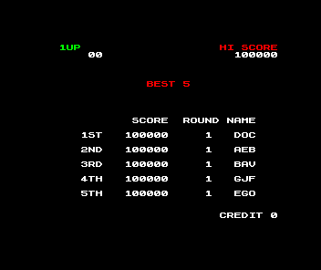

# Rainbow Islands: capture the settled high-score page

Rainbow Islands' catalogue waypoint now captures the midpoint of the first
settled BEST 5 page, at native field 1755. Both original expected hashes are
unchanged. The old field-6000 waypoint captures the preceding credits fade.
This repairs the test's navigation; it does not qualify every aspect of +3
hardware timing.

Source change: [Emu198x #2289](https://github.com/emu198x/emu198x/pull/2289),
commit `9bb16aafbc0a8b62acc825c0ab6e63c003da8009`, based on
`eed1923b47965069b342194563b0b83849f6a5d5`. The entire shipping diff is one wait value, its explanation and changelog.
The exact patch is retained in the private archive and visible in the source PR.
No engine, firmware, disk, routing version, mask or save format changes.

## Identify the page before choosing a field

The original guest program distinguishes title, credits and high-score pages
through their callers. Its first high-score page-complete delay entry is at
`CFC9`, with `SP=FFFA`, saved `BC=D000` and caller return `CFAD`. The title and
credits callers are `CF91` and `CF9F`. These observations come from the original
program, rather than inferring its state from a stored image hash.

An untuned 3600-field trace from ordinary disk autoload records every frame.
The first complete, stable high-score page spans **1535–1976 inclusive**:
442 fields. Its next occurrence spans 3030–3471, also 442 fields. We use the
floor midpoint, 1755, following the existing Banshee convention in
[catalogue-startup-navigation.md](https://github.com/emu198x/emu198x/blob/main/knowledge/decisions/catalogue-startup-navigation.md).
The earlier continuation from the old waypoint independently finds the same
page at 6020–6461. Complete run-length records are retained in
[first-cycle-stable-windows.json](first-cycle-stable-windows.json) and
[post-waypoint-stable-windows.json](post-waypoint-stable-windows.json).

Read-only MAME 0.289 observation reaches the original program milestone at
41.486771828817 seconds. After allowing two native fields for presentation,
all 64 consecutive native pictures have the original RGB hash
`xxh64:9c88024738effebd`. The entire displayed bank-5 screen, 6912 bytes,
agrees with Emu198x's settled page. Its SHA-256 is
`21f2afed962ea4d29f2fb5c4985162c54791a97f5ffcc942067b04b134767c93`.
See [highscore-independent-proof.json](highscore-independent-proof.json).



Screenshot of Rainbow Islands: The Story of Bubble Bobble 2 (Taito;
ZX Spectrum conversion by Graftgold, published by Ocean, 1990), reproduced
here as emulator validation evidence.

## Reference controls and limitations

The original extended DSK declares 45 tracks, with tracks 39–44 unformatted.
MAME's physical 42-track drive rejects that declaration. Its separately named
diagnostic view changes only header byte 48, from 45 to 42; all track payload
bytes remain identical. We preserve the original ZIP/disk, verify both source
and mounted copy after execution, and never use the derived view in Emu198x.
Input identities are in [reference-input-identity.json](reference-input-identity.json)
and the derived identity in [reference-reproduction.json](reference-reproduction.json).
This is a disclosed reference-input accommodation, not a canonical-media fix.

The observer does not replace any read value or write guest memory. Its later
125.35-second physical RAM and pixels equal the untapped control. Separately,
64 fields with CPU-map reads reproduce every register record, physical RAM
snapshot and native pixel buffer from a physical-RAM-only observer:
[mame-observer-control.json](mame-observer-control.json). A fresh run of the
published wrapper/Lua reproduces all 64 RAM/pixel records and the milestone
byte-for-byte: [reference-reproduction.json](reference-reproduction.json).
MAME is independent implementation evidence, not original-hardware proof.

## Verification

The clean production binary passes the ordinary catalogue run and its
snapshot/replay check. A separate fresh capture retains both original goldens:

| Surface | Original and repaired expectation |
|---|---|
| Frame | `xxh64:9c88024738effebd` |
| Audio | `xxh64:7d335937455497a1` |

The same binary with the original 6000-field manifest exits **1** with
`boot mismatch`, observing `xxh64:c5a96435f59811ff`; snapshot replay still passes.
The new manifest exits **0**, with one entry run, zero failures and both PASS
and SNAP-PASS. Raw command output and producer/manifest identities are in
[verification.json](verification.json). All 45 catalogue tests and release
Clippy pass; the corresponding logs are retained here. Source CI passed its
24 applicable checks; ten release/coverage jobs were skipped as configured.

[combined-ledger.json](combined-ledger.json) combines **one fresh capture and
102 reused observations** from the identified previous full sweep. It is not
a new 103-case run. The manifests parse identically after restoring this one
wait value; all expected hashes are unchanged. The combined result is 94
matching entries and nine remaining +3 failures. The other 102 observations
are the previous producer's measurements, not independent executions of this
commit. `reconcile.py` rejects empty, missing, duplicate and unexpectedly
changed-entry inputs before writing a result.

## A verified producer for the five audio-only failures

The exact historical recapture commit
`cf6ee98c2857c37b0683945107c695c316a49fcc` builds unchanged, with its pinned
installed Rust 1.99.0 and locked dependencies. It reproduces **both complete
original frame and audio hashes in all five cases**: Chase H.Q., Starglider 2,
Lotus Esprit Turbo Challenge, RoboCop and Where Time Stood Still.
[baseline-five-results.json](baseline-five-results.json) records each result,
the binary identity and every complete ROM, ZIP and disk SHA-256.
[baseline-build-result.json](baseline-build-result.json) records the unchanged
source and successful bounded build.

The v0.28.0 release tag predates the relevant audio recapture and differs in
Spectrum audio code. It is not a substitute for this exact producer. These
five successful historical captures establish a baseline for the next audio
comparison; they do not resolve the current producer's nine outstanding cases.

## Reproduce

With the original local firmware/media in the normal catalogue roots, build
source `9bb16aafbc0a8b62acc825c0ab6e63c003da8009` in release mode, then run:

```sh
cargo run --locked --release -p emu198x-catalogue --bin catalogue -- run --entry rainbow-islands-plus3
cargo run --locked --release -p emu198x-catalogue --bin catalogue -- capture --entry rainbow-islands-plus3
```

Extract the old/new manifests from base/changed commits with `git show`, then
run the same production binary with `--manifest OLD` to obtain the negative
control. Given those two manifests, the prior report and this fresh evidence:

```sh
python3 reconcile.py OLD NEW ../2026-11-04-amstrad-audio-phase/recapture.json verification.json /tmp/rainbow-ledger.json
```

The reference wrapper deliberately requires the exact MAME and input hashes
recorded here. With those originals available at the recorded paths:

```sh
python3 run_reference.py --script highscore_first_milestone.lua --output /tmp/rainbow-reference-new
```

It bounds execution, requires the completion sentinel, checks immutable inputs
and removes its temporary ROM/disk directory. The Lua requires 64 sequential
native frame numbers. Inspect all 64 output pairs, rather than treating MAME's
process exit alone as a pass.

For the historical baseline, check out the exact commit above and use
`cargo +1.99.0 build --locked --release -p emu198x-catalogue --bin catalogue`.
Run `capture --entry ID --manifest crates/emu198x-catalogue/manifest/spectrum.toml`
for each of the five IDs in `baseline-five-results.json`; compare both hashes.

Private raw observations, original probe versions, failed diagnostic attempts
and both exact production binaries are retained in the source repository's
local recovery archive. No ROM, game RAM or music recording is published here.

The private archive contains 3399 verified files; SHA-256
`77a669d7cd0910e56c49a9a30fc7c3eb12c6fd3516c78a3ca45687b2b4e5f9e9`.
Its local location and verification record are in [private-archive.json](private-archive.json).
